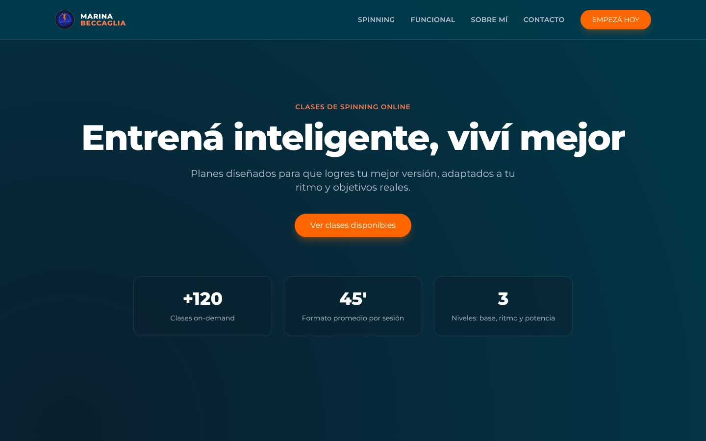
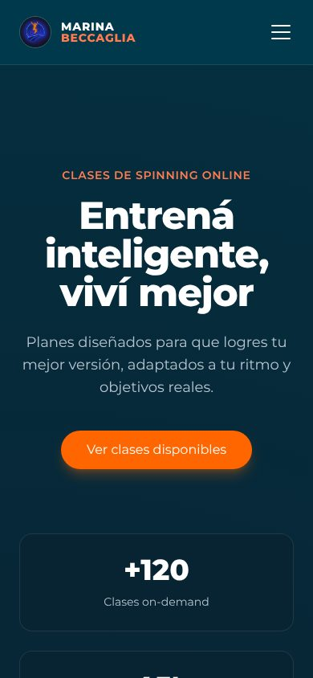

# Marina Beccaglia · Spinning & Entrenamiento Funcional 🚴‍♀️

[](https://github.com/fernandezvalentin/spinning-frontend/actions/workflows/ci.yml)


**🔗 Demo en vivo: [spinning-frontend.vercel.app](https://spinning-frontend.vercel.app)**

Sitio web real para **Marina Beccaglia**, instructora certificada de Spinning® y Profesora Nacional de Educación Física. Presenta sus clases de spinning online y sus planes de entrenamiento funcional, y lleva a los alumnos a contactarla o a su plataforma de clases.

<p align="center">
  
  &nbsp;
  
</p>

## ✨ Funcionalidades

**Landing pública**
- Diseño *mobile-first* con menú hamburguesa animado y accesible.
- Animaciones al hacer scroll con Framer Motion.
- Secciones de clases, planes funcionales, perfil y contacto (WhatsApp e Instagram).
- Botón flotante de WhatsApp y mensajes precargados según el botón, para que la instructora sepa qué plan le consultan.
- SEO básico: `title` y `description`, favicon, idioma `es` e imagen Open Graph para compartir en WhatsApp y redes.

**Área de alumnos y panel de administración** (requiere el backend)
- Registro e inicio de sesión con JWT, con la sesión guardada en el navegador.
- Rutas protegidas para alumnos (`/clases`) y para administradores (`/admin`).
- Pago de la suscripción con checkout externo. La pantalla `/pago-exitoso` consulta al backend hasta confirmar que el pago se acreditó.
- Clases en video desde Vimeo. Se acepta tanto el ID como el link completo.
- CRUD de clases para la administradora.

## 🧱 Stack y decisiones técnicas

| Área | Elección | Por qué |
|---|---|---|
| UI | React 19 + TypeScript (`strict`) | Tipado de punta a punta: modelos (`src/types.ts`), API y contexto |
| Build | Vite 7 | Arranque instantáneo en desarrollo y build optimizado |
| Estilos | Tailwind CSS 4 con tokens en `@theme` | Paleta y tipografía centralizadas en `index.css` |
| Routing | React Router 7 (data router) | Rutas anidadas con *guards* de autenticación y de rol |
| Estado de sesión | Context API + hook `useAuth()` | Simple y suficiente para este alcance, sin librerías extra |
| HTTP | Axios con un helper `request<T>()` | Un solo lugar para normalizar los errores del backend |
| Performance | *Code splitting* con `React.lazy` | La landing no descarga el reproductor de video ni el panel de admin |
| Deploy | Vercel + `vercel.json` | Rewrites para que funcionen las URLs de la SPA al recargar |
| Calidad | ESLint + `tsc` + GitHub Actions | Cada push y cada PR corren lint, chequeo de tipos y build |

## 📁 Estructura

```
src/
├── components/   # Layout, Navbar, botón de WhatsApp y guards de rutas
├── config/       # Datos de contacto y mensajes precargados
├── context/      # AuthProvider + hook useAuth()
├── pages/        # Home, Login, Register, Clases, PagoExitoso, AdminDashboard, NotFound
├── services/     # Cliente HTTP tipado (api.ts)
├── utils/        # Helpers (normalización de links de Vimeo)
└── types.ts      # Modelos compartidos: Usuario, Clase
```

## 🚀 Correrlo en local

```bash
git clone https://github.com/fernandezvalentin/spinning-frontend.git
cd spinning-frontend
npm install
cp .env.example .env   # opcional: URL del backend
npm run dev
```

| Script | Qué hace |
|---|---|
| `npm run dev` | Servidor de desarrollo |
| `npm run build` | Chequeo de tipos y build de producción |
| `npm run lint` | ESLint |
| `npm run typecheck` | Solo TypeScript |
| `npm run preview` | Sirve el build localmente |

### Variables de entorno

| Variable | Default | Descripción |
|---|---|---|
| `VITE_API_URL` | `http://localhost:5001/api` | URL base del backend REST |

## 🗺️ Próximos pasos

- [ ] Publicar el backend y conectar el área de alumnos en producción
- [ ] Tests de componentes con Vitest y Testing Library
- [x] Imagen Open Graph para compartir en redes
- [ ] Imágenes en formato WebP/AVIF

---

Desarrollado por **[Valentín Fernández](https://github.com/fernandezvalentin)**.
